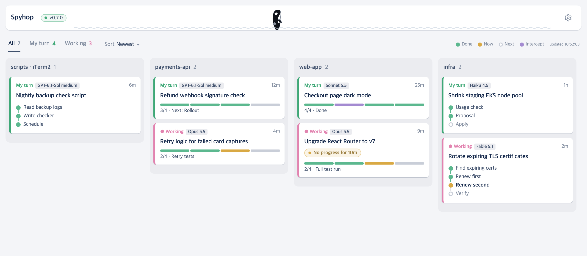
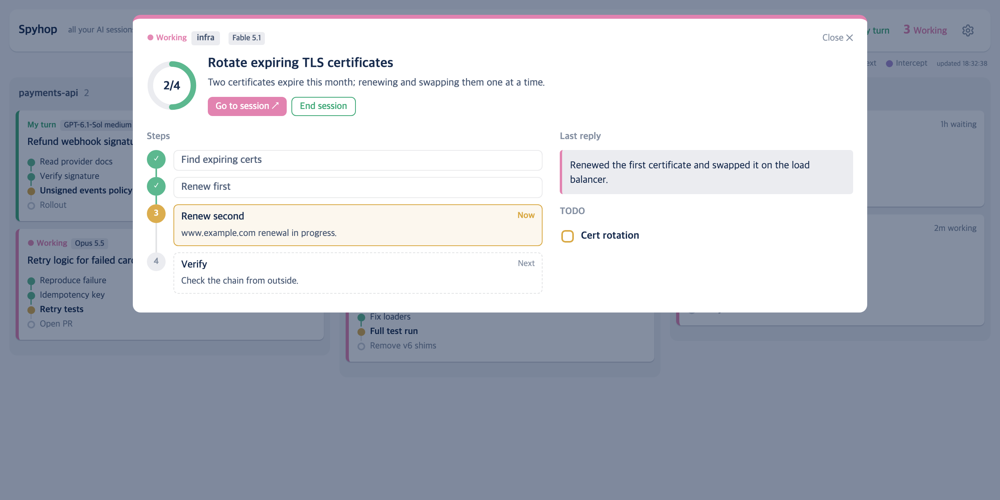
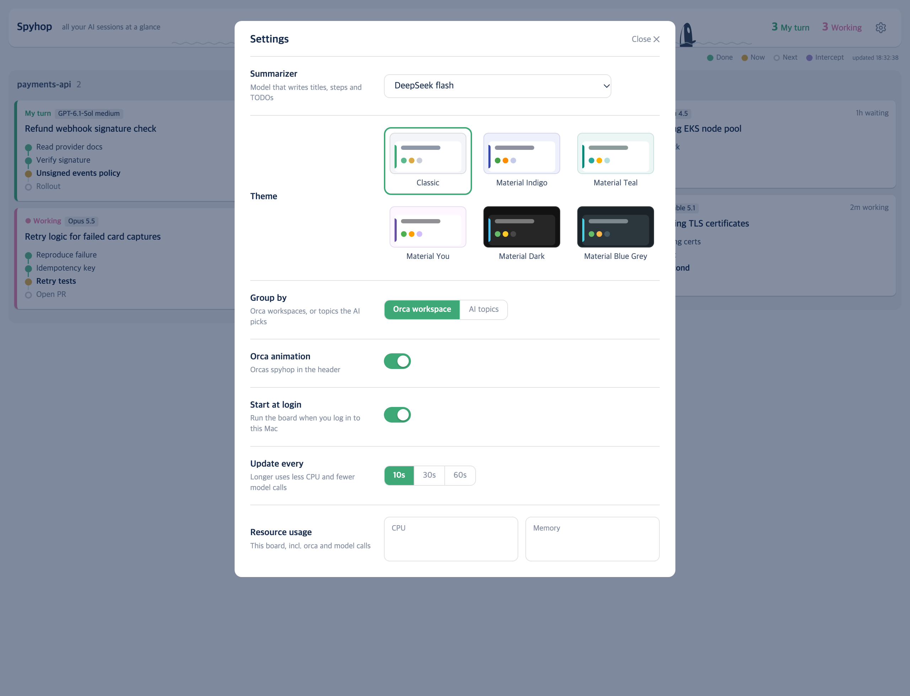

<p align="center">
  
</p>

<h1 align="center">Spyhop</h1>

<p align="center">
  <b>Every AI coding session on one board, each with its own progress.</b><br>
  <sub>See all your Claude Code, Codex and OMP sessions at once, and how far each one has come: done, now, next.</sub>
</p>

<p align="center"><a href="https://leeleelee3264.github.io/spyhop/"><b>Tour the features (intro page with demo video) →</b></a></p>

<p align="center">
  
  
  
  
  
  
  
</p>



<sub>Demo data. The last column is a session started in iTerm2, outside Orca.</sub>

Spyhop does two things:

- **All sessions in one place.** Every Claude Code and Codex session you have open becomes a card on one board, with the ones waiting for you on top. No more flipping through panes to find out which one finished or got stuck.
- **Progress for each session.** Spyhop reads the transcript and lays the work out as steps (what's done, what it's on now, what's next), like a progress page for every session. As the work moves, finished steps stay put and the current step moves forward, so you can tell how far it has come at a glance.

In Orca, drag a card to another workspace and the session moves there, conversation and all:


## Install

```bash
brew install leeleelee3264/tap/spyhop
spyhop
```

- **Needs** one summarizer (below). [Orca](https://github.com/stablyai/orca) is optional: Spyhop finds sessions from the running `claude` and `codex` processes.
- **Opens** in Orca as a **Spyhop** workspace if you have it, and always at `http://127.0.0.1:47613/`.
- **Menu bar** (optional): `brew install --cask swiftbar`, then run `spyhop` once more. The orca icon is added for you.

**Update** to the latest version:

```bash
brew upgrade spyhop && spyhop
```

From 0.6.0 on, a running board switches to the new version by itself within a minute after `brew upgrade`, and every open board tab reloads. The version next to the title is highlighted until you rest the pointer on it (or for a day); the tooltip says what it was updated from and links to the release notes. Settings, topic columns and your AI sessions are kept. Running `spyhop` does the same right away. If your board started on 0.5.0 or older, run `spyhop` once after this upgrade.

## OMP (Oh My Pi)

Spyhop also reads Oh My Pi sessions. Start OMP once after installation, then run `spyhop` and restart OMP sessions so they load the bundled status extension. It records only PID, process start time, session ID, transcript path, folder and busy/idle state in `~/.spyhop/omp/`; summaries use the same summarizer as Claude and Codex.

The extension is installed at `~/.omp/agent/extensions/spyhop-status.ts` when the OMP agent directory exists (or `PI_CODING_AGENT_DIR` when set for `spyhop`). OMP must allow its normal extension discovery. Go to session and End session use the existing terminal controls. AI topic grouping works; moving OMP sessions between Orca workspaces is not supported yet. Tested with Oh My Pi 18.12.2.

## Terminals

Spyhop finds sessions from the running `claude` and `codex` programs, so they show up wherever you start them. Orca adds a few extras.

| | Orca | Terminal, iTerm2, Ghostty, WezTerm | Other terminals |
|---|---|---|---|
| Card, steps, summary, detail view | ✅ | ✅ | ✅ |
| Columns (Group by: Location) | Orca workspaces | folder and terminal (e.g. `workspace · iTerm2`) | folder and terminal |
| Go to session | the exact pane | the exact tab | brings the app to the front |
| End session | closes that split pane | stops the AI program, the tab stays | stops the AI program, the tab stays |
| Drag a card to move the session to another workspace | ✅ | ❌ | ❌ |
| Helper line under a card (cross-check panes started through Orca) | ✅ | ❌ | ❌ |
| AI topic grouping | ✅ | ✅ | ✅ |
| `spyhop doctor` | ✅ | ✅ | ✅ |

Without Orca installed, everything in the last two columns still works. tmux and SSH sessions outside Orca are not supported.

If a session is missing or looks wrong, run `spyhop doctor`. It explains, card by card, how each session was found or why it was not, without printing titles or prompts (`--titles` to show them).

## Summarizer

Spyhop uses the AI you already have: a logged-in `claude` or `codex` CLI. Switch models in **Settings → Summarizer**.
Transcripts go to the model you pick (keys and passwords are masked first), so pick one your organization allows.

How much it uses: only sessions whose transcript changed are summarized, at most once a minute each (once every 3 or 5 minutes at the 30 s or 60 s update interval), and only the new part of the transcript is sent. Idle sessions cost nothing. Measured on one Mac over 30 minutes with 6 sessions open, a few of them working: 53 summarizer calls, about 4,500 characters sent per call.

## What you get

- **Step flow** on every card: `Done` · `Now` · `Next`, plus purple `Intercept` for a quick side task. When space runs out, cards shrink to progress bars (`3/4 · Review`).
- **No progress** badge when a working session hasn't written anything for 5 minutes.
- **Helpers**: panes a session starts through Orca orchestration (a cross-check, a review) appear as one line under that session, not as their own card. If that session's pane is closed, the helper shows as its own card.
- **Detail view**: every step explained, the last reply, a TODO checklist, the session ID, and buttons to jump to or end the session.



- **Group by AI topics** instead of Location (the Orca workspace, or the folder and terminal each session runs in). Drag a card to another topic to pin it there, or drop it on **+ New column** to make your own topic. Pinned cards stay put when the AI sorts new sessions.
- **Filter and sort**: tabs above the board show All / My turn / Working with their counts; pick one to see only those cards (columns left empty are hidden). The small **Sort** menu next to them picks Newest or Longest wait; cards and columns both follow it, and a moving column slides as one block. Both choices are remembered.
- **Narrow windows**: columns wrap onto the next row (3 across in a 900px window, 1 on a phone). A column too long for the screen scrolls inside itself.


- **Settings**: summarizer, 9 themes (Classic plus GitHub, One, Ayu, Vitesse and VS Code in light and dark), start at login, update interval, live CPU and memory.



- **Menu bar**: how many sessions are waiting for you; click a row to jump there.


## Uninstall

```bash
brew uninstall spyhop && rm -rf ~/.spyhop
```

Turn off **Start at login** in Settings first, and remove the **.spyhop** project from Orca's sidebar.

## More

- Feature tour with screenshots and a demo video (Korean and English): https://leeleelee3264.github.io/spyhop/
- How it works, privacy and file locations: [docs/details.md](docs/details.md).

## TODO

- [x] Work without Orca: sessions in Terminal, iTerm2, Ghostty and WezTerm, grouped by folder and terminal.
- [x] `spyhop doctor` to explain missing or wrong cards.
- [ ] A "reset groups" button for AI topics.
- [ ] Moving a session to another workspace, made safe end to end.
- [ ] Notify when a session turns to "My turn".
- [ ] Search past Claude and Codex sessions and reopen one (`claude --resume` / `codex resume`) from the board.
