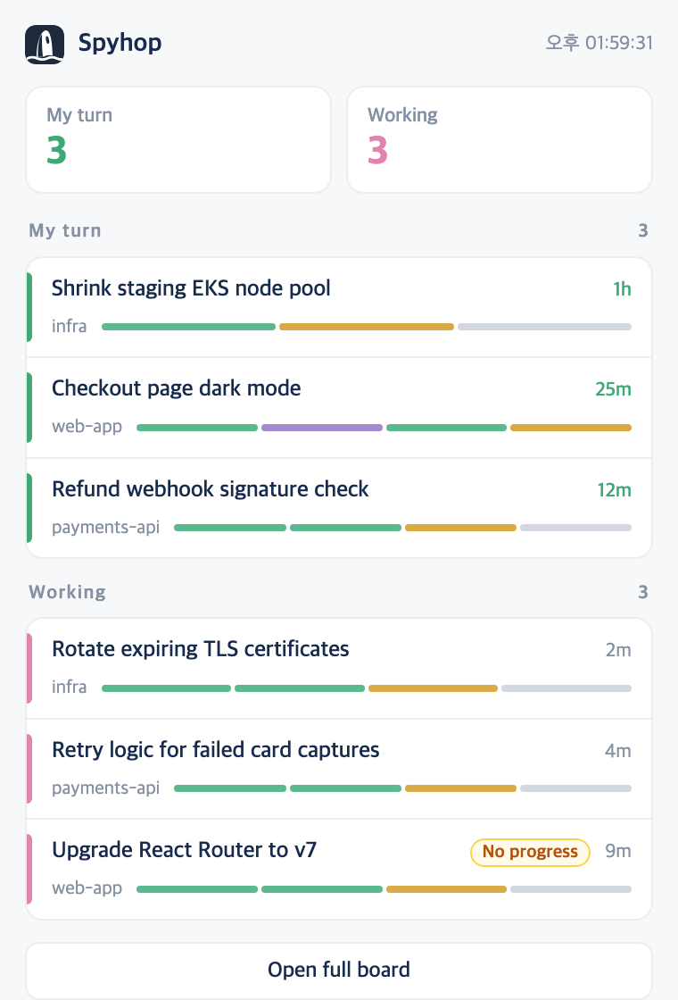
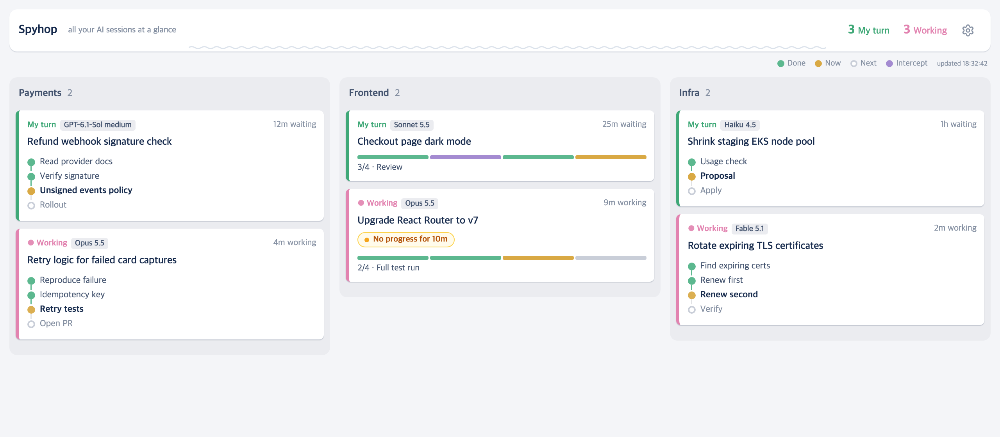

<p align="center">
  
</p>

<h1 align="center">Spyhop</h1>

<p align="center">
  <b>See which of your AI coding sessions is waiting for you.</b><br>
  <sub>Spyhop puts every Claude Code, Codex, GitHub Copilot CLI and OMP session on one board, with how far each one has come: done, now, next.</sub>
</p>

<p align="center">
  <a href="https://github.com/leeleelee3264/spyhop/releases/latest"></a>
  
  
  <a href="LICENSE"></a>
</p>

<p align="center"><sub>Works in <b>Orca</b>, <b>Terminal</b>, <b>iTerm2</b>, <b>Ghostty</b>, <b>WezTerm</b>, <b>cmux</b> and the <b>Claude desktop app</b>.</sub></p>

```bash
brew install leeleelee3264/tap/spyhop && open -a Spyhop
```


<sub>Demo data. The last column is a session started in iTerm2, outside Orca.</sub>

- **Know whose turn it is:** sessions waiting for you rise to the top of the board, and the orca in the menu bar shows how many there are.
- **Progress for each session:** Spyhop reads the transcript and lays the work out as steps: what's done, what it's on now, what's next.
- **Jump to the session:** click a card to go to that exact Orca pane or terminal tab.
- **Grouped by topic:** switch to AI topics and the AI puts sessions doing related work in one column, by what the work is about rather than which folder it runs in.

<table>
  <tr>
    <td width="66%"><br><sub><b>My turn</b>: only the sessions waiting for you.</sub></td>
    <td width="34%"><br><sub><b>Menu bar</b>: how many sessions are waiting, and a click jumps to one.</sub></td>
  </tr>
  <tr>
    <td><br><sub><b>AI topics</b>: related work in one column.</sub></td>
    <td><br><sub><b>Detail view</b>: every step, the last reply and the TODO list.</sub></td>
  </tr>
</table>

<p align="center"><a href="https://leeleelee3264.github.io/spyhop/"><b>Tour all features (intro page with demo video) →</b></a></p>

## What works where

| | Orca | Terminal, iTerm2, Ghostty, WezTerm, cmux | Claude desktop app | Other terminals |
|---|---|---|---|---|
| Go to session | the exact pane | the exact tab | that session | brings the app forward |
| Drag a card to another workspace | ✅ | ❌ | ❌ | ❌ |
| Cross-check line under a card | ✅ | ❌ | ❌ | ❌ |

Cards, steps, summaries, the detail view, AI topics and the doctor work everywhere. tmux and SSH sessions outside Orca are not supported. Full table and cmux setup: [guide](docs/guide.md#what-works-where).

## Get started

You need macOS 13 or later, Homebrew, the Xcode Command Line Tools (for Python) and a logged-in `claude` or `codex` CLI, which Spyhop uses to summarize. [Orca](https://github.com/stablyai/orca) is optional.

```bash
xcode-select --install    # skip if already installed
brew install leeleelee3264/tap/spyhop
open -a Spyhop
```

The board opens in its own window, and the orca in the menu bar shows how many sessions are waiting for you. Start or keep a Claude Code or Codex session running and it shows up as a card within a few seconds. Click a card to see every step, the last reply and its TODO list. **Go to session** jumps to that pane or tab.

Closing the window keeps the orca in the menu bar; **Start at login** in Settings opens it there at login.

### Update

```bash
brew update
brew upgrade --cask leeleelee3264/tap/spyhop
open -a Spyhop
```

From 2.1.0 on, **Spyhop → Check for Updates…** inside the app does the same.

### Troubleshoot

If a session is missing or looks wrong, the doctor explains, card by card, how each session was found or why it was not:

```bash
/usr/bin/python3 /Applications/Spyhop.app/Contents/Resources/spyhop/board.py --doctor
```

Coming from the browser version, using OMP or cmux, or uninstalling: see the [guide](docs/guide.md). On Windows? A community-maintained preview lives in [`windows/`](windows/README.md). It is separate from the macOS app and not installed through Homebrew.

## Privacy and cost

Only the transcript leaves your Mac. It goes to the summarizer model you pick in **Settings**, with anything that looks like a key or password masked first.

Spyhop summarizes a session only when its transcript changed, at most once a minute, and sends only the new part. Idle sessions cost nothing. Measured over 30 minutes with 6 sessions open: 53 summarizer calls, about 4,500 characters each. More in [docs/details.md](docs/details.md).

## Roadmap

- [x] Work without Orca: sessions in Terminal, iTerm2, Ghostty, WezTerm and cmux, grouped by folder and terminal.
- [x] A doctor (`board.py --doctor`) to explain missing or wrong cards.
- [ ] A "reset groups" button for AI topics.
- [ ] Moving a session to another workspace, made safe end to end.
- [ ] Notify when a session turns to "My turn".
- [ ] Search past Claude and Codex sessions and reopen one (`claude --resume` / `codex resume`) from the board.

## License

[MIT](LICENSE)
